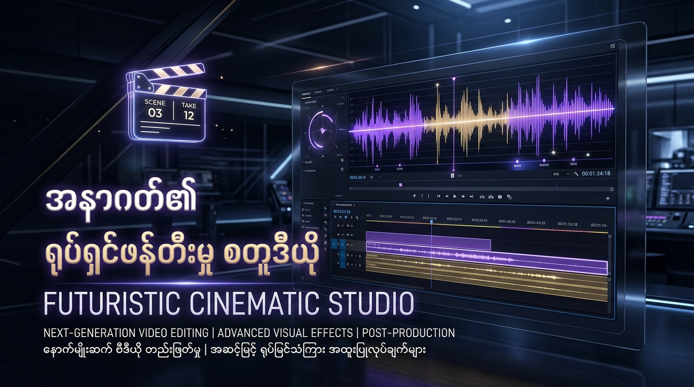
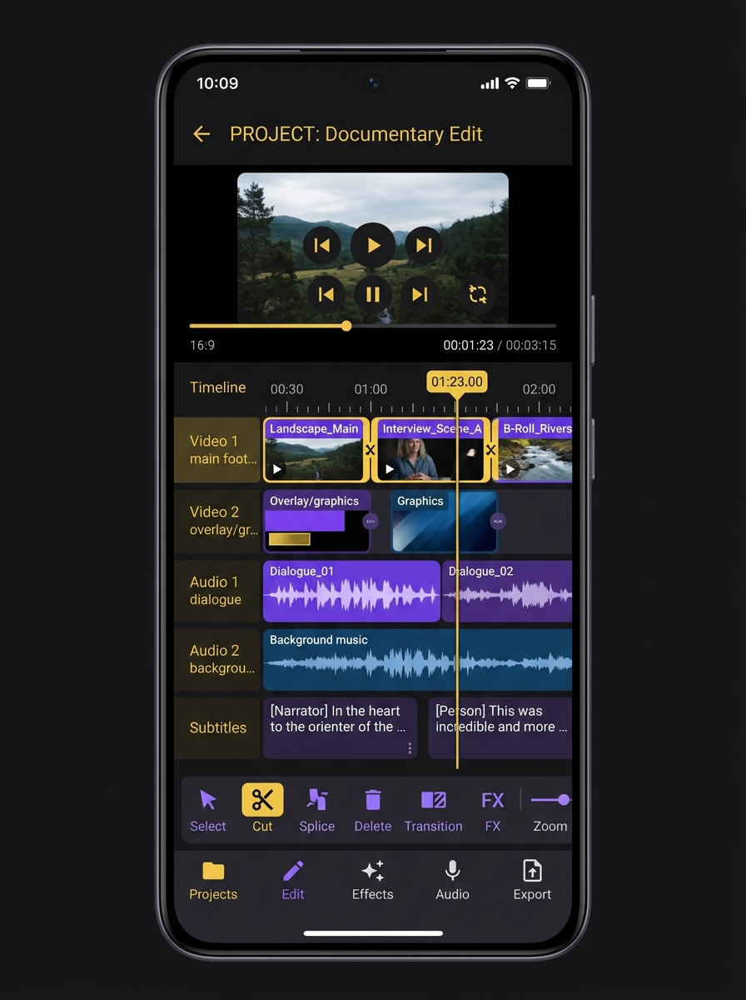
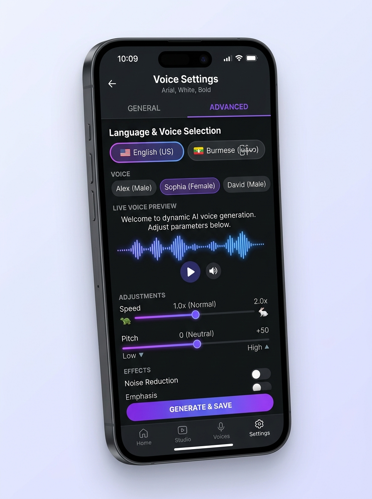

# Movie Recap Studio (Android)

Movie Recap Studio သည် AI နည်းပညာကို အသုံးပြု၍ ရုပ်ရှင်ကားများ၏ ဇာတ်ဝင်ခန်းများကို အလိုအလျောက် ခွဲခြားပေးခြင်း၊ **မြန်မာ (Burmese) နှင့် English** နှစ်ဘာသာဖြင့် နောက်ခံစကားပြော (Narration) များ ထည့်သွင်းပေးခြင်းနှင့် စနစ်တကျ ဗီဒီယိုတည်းဖြတ်နိုင်ခြင်းတို့ကို လုပ်ဆောင်ပေးနိုင်သော Professional-grade Android Application တစ်ခုဖြစ်ပါသည်။

## ✨ အဓိက လုပ်ဆောင်ချက်များ (Key Features)

### 🎬 Professional Video Editor & Timeline
- **Multi-Track Editing**: Video, Audio (Narration/BGM), နှင့် Subtitles track များအား စနစ်တကျ တည်းဖြတ်နိုင်ပါသည်။
- **Aspect Ratio Control**: TikTok/Reels အတွက် `9:16`၊ YouTube အတွက် `16:9` နှင့် Instagram အတွက် `1:1` ပုံစံများကို တစ်ချက်နှိပ်ရုံဖြင့် ပြောင်းလဲနိုင်ပါသည်။
- **FFmpeg Engine**: အရည်အသွေးမြင့် MP4 ဗီဒီယိုများကို 720p မှ 4K အထိ Render လုပ်ထုတ်ယူနိုင်ပါသည်။

### 🎙️ AI Narration & TTS (မြန်မာအသံများ)
- **Burmese Voices**: အောင် (Deep Cinematic)၊ နီလာ (Warm Story)၊ သီရိ (Soft Doc)၊ ကျော် (Action) စသည့် မြန်မာနောက်ခံစကားပြော အသံများကို ရွေးချယ်နိုင်ပါသည်။
- **Speech Controls**: အသံ၏ အနှေးအမြန် (Speed) နှင့် Pitch များကို စိတ်ကြိုက်ညှိနိုင်ပါသည်။
- **Custom Audio Upload**: မိမိကိုယ်ပိုင် Voiceover ဖိုင်များကိုလည်း တိုက်ရိုက် Upload တင်၍ အသုံးပြုနိုင်ပါသည်။

### 💬 Subtitle Studio (SRT/VTT)
- **Auto Transcript**: အသံမှ စာသားသို့ အလိုအလျောက် ပြောင်းလဲပေးခြင်း။
- **Import/Export**: ပြင်ပမှ `.srt` / `.vtt` ဖိုင်များကို Import တင်နိုင်ပြီး တည်းဖြတ်ပြီးပါကလည်း ပြန်လည် Export ထုတ်နိုင်ပါသည်။
- **Timestamp Shifting**: စာတန်းထိုး အချိန်များကို တစ်ပြိုင်နက်တည်း အရှေ့အနောက် ရွှေ့နိုင်ပါသည်။

### 🔑 BYOK (Bring Your Own Key) Settings
- User များအနေဖြင့် မိမိတို့၏ ကိုယ်ပိုင် API Key များကို အသုံးပြု၍ ပိုမိုကောင်းမွန်သော AI Performance ကို ရယူနိုင်ပါသည်။
  - **Gemini API** (AI Scripting)
  - **ElevenLabs API** (Premium TTS)
  - **AssemblyAI / OpenAI** (Transcription)

## 📸 App Interface Mockups

| Timeline Editor | Voice Generation |
| :---: | :---: |
|  |  |

## 🛠️ နည်းပညာပိုင်းဆိုင်ရာ (Tech Stack)

- **Language**: Kotlin & Jetpack Compose
- **Architecture**: MVVM with Clean Architecture
- **Database**: Room (Local Persistence), DataStore (Encrypted Settings)
- **Video Processing**: FFmpeg & Video Analyzer
- **CI/CD**: GitHub Actions (Auto APK Build & Release)

## 📥 အသုံးပြုနည်း (Getting Started)

1. GitHub ၏ **[Releases](https://github.com/amkyawdev/A201/releases)** Page သို့သွားပါ။
2. နောက်ဆုံးထွက်ရှိထားသော **`MovieRecapStudio_vX.X.X_Debug.apk`** ကို Download ရယူပြီး Install ပြုလုပ်ပါ။
3. အက်ပ်အတွင်းရှိ **Settings** တွင် သင်၏ API Key များကို ထည့်သွင်း၍ စတင်အသုံးပြုနိုင်ပါပြီ။

---
**Developed by amkyawdev** 🚀
